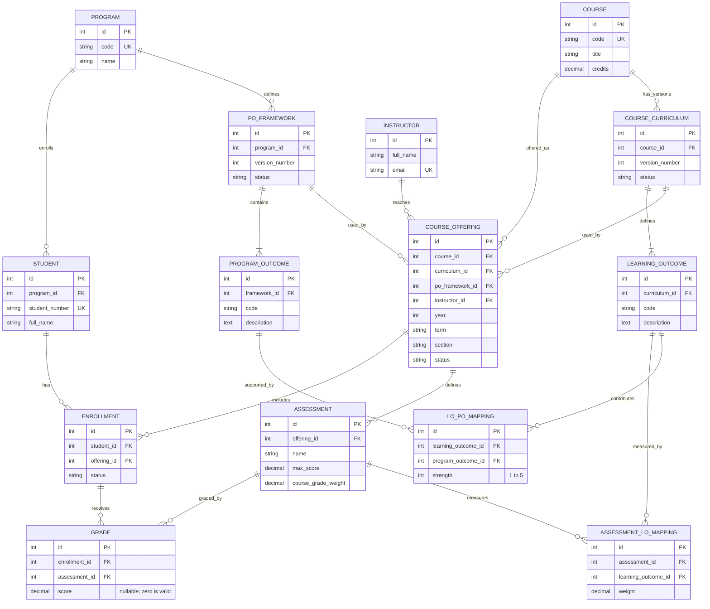

# Gnosis — ER Diagram (Draft v0.1)

**Scope:** CSE311/CSE321 combined project, Fall 2026. This is a proposed design, not a mandated schema. The brief requires a Django web application managing per-student PO scores using Assessment → LO → PO weighted relationships.

## Constraints to implement

- Unique: `(course_id, version_number)` for COURSE_CURRICULUM; `(program_id, version_number)` for PO_FRAMEWORK; `(curriculum_id, code)` for LEARNING_OUTCOME; `(framework_id, code)` for PROGRAM_OUTCOME.
- Unique: `(course_id, year, term, section)` for COURSE_OFFERING; `(student_id, offering_id)` for ENROLLMENT; `(enrollment_id, assessment_id)` for GRADE; `(assessment_id, learning_outcome_id)` for ASSESSMENT_LO_MAPPING; `(learning_outcome_id, program_outcome_id)` for LO_PO_MAPPING.
- Positive credits and assessment max scores; grade `NULL` means ungraded, `0` means a confirmed zero; grade must lie between 0 and its assessment max score.
- Assessment LO weights are positive and normalized **per target LO** when calculating that LO. Do not require each assessment's outgoing LO weights to sum to 100%: the instructor's example has Midterm→LO1 60%, Midterm→LO2 40%, Project→LO1 40%, Project→LO2 100%.
- The assessment's offering and grade's enrollment offering must match. Assessment mappings must reference outcomes from the offering's chosen course curriculum. LO→PO mappings used for an offering must target its chosen PO framework. These are cross-table invariants requiring service/model validation and tests.
- An offering's course must equal the curriculum's course; PO framework should be compatible with the student's program or a declared cross-program policy.
- `course_grade_weight` is **not** the same as `ASSESSMENT_LO_MAPPING.weight`.
- Published curricula/frameworks should not be edited in place after use; use new versions. Finalized report revisions and audit logs are deferred.

## Calculation contract

1. Normalize each recorded assessment score to 0–100 via `100 * score / max_score`.
2. LO score = weighted average of available assessment scores contributing to that LO. Missing grades are excluded from provisional calculation, but coverage/status shows missing weight; confirmed zero is included. Finalization requires completeness.
3. PO score within one course = weighted average of that course's LO scores using LO→PO strength 1–5. This matches the brief's worked example.
4. Across courses, calculate a student-specific PO weighted average from eligible completed course contributions. **Proposed extension:** weight each course's PO result by its credits and a documented evidence-strength policy; do not multiply full course credits once per LO without normalizing first. Track proficiency separately from coverage; coverage requires a program-defined evidence target (not yet modeled).
5. No evidence ⇒ `NULL`/not assessed, not 0%. Cross-framework PO scores are kept separate absent approved equivalence rules.

## Delivery scope

**V1:** All ERD tables above; admin/sample-data entry; weighted LO and PO calculations; 3 meaningful SQL queries; basic instructor/student views; model and calculation tests.

**Later:** outcome equivalence between PO frameworks, grade correction audit, immutable final report revisions, program-defined coverage requirements, elective/waiver policy, multiple instructors per offering, integrations.

## Requirements traceability

- Guidelines pp. 2, 4–7: Django web system for individual student PO scores; 11 POs; assessment→LO→PO weighted average; LO→PO course contribution strength 1–5.
- Guidelines pp. 8–10: team decides permissions, grade entry, mappings, UX and integrations; working functionality is mandatory.
- Guidelines pp. 14, 18: CSE321 architecture, class/object relationships, schema/data model required for checkpoint.
- Versioning, credits-based aggregation, and snapshots are **team design extensions**, not stated mandatory requirements.
