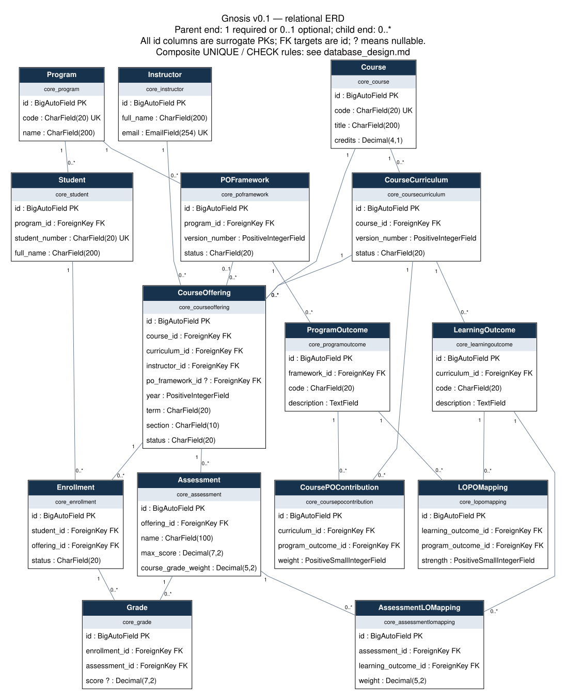

# Gnosis v0.1 database model and ERD

Verified on 1 November 2026 against application source at `31890b81b43c9479c4d4ec5ea8fa4b87ee48f403`, migrations `core.0001`–`core.0009`, and a fresh fictional pilot database. This documents existing behavior; it does not approve a schema redesign or institutional policy. Prepared for review under [issue #2](https://github.com/TugraDuygulu/gnosis/issues/2) and the CSE321 Section 3 material tracked by #13.

## 1. Scope and evidence

The application has **15 models, 15 application tables, 64 columns and 20 foreign keys**. Django authentication, sessions, content types, migration records and admin logging are separate infrastructure tables. Grade-change history uses `django_admin_log`; it is not a sixteenth application model.

Sources of truth, in order: [models](../core/models.py), [migrations](../core/migrations/), [calculation services](../core/services/), [native intake validation](../core/student_intake.py), and [calculation policy](calculation_policy.md). The supplied `Gnosis_database_design_v01_review_draft.md` was a review input, independently checked rather than adopted as authority.

The physical inventory was measured using Python 3.14.3, Django 6.1.2 and Python SQLite 3.50.4. The system SQLite 3.54.0 CLI read the same temporary database in read-only mode for `dbstat`, because this Python SQLite build lacks that virtual table. Exact DDL, field metadata, FK actions, index columns, source hashes and runtime details are preserved in [schema_inventory.json](data/pilot_2026-11-01/schema_inventory.json).

## 2. Diagram and relationships



The complete diagram is available as [Mermaid source](diagrams/gnosis-erd.mmd), [SVG](diagrams/gnosis-erd.svg) and [PNG preview](diagrams/gnosis-erd.png). For report-sized pages, use the focused views below rather than shrinking the complete diagram until its fields become unreadable:

| View | Report purpose | Editable source / export |
| --- | --- | --- |
| Academic context | Program, student, curriculum/framework version, offering and enrollment | [Mermaid](diagrams/gnosis-erd-context.mmd) / [SVG](diagrams/gnosis-erd-context.svg) |
| Assessment evidence | Offering, enrollment, grades, curriculum LOs and assessment mappings | [Mermaid](diagrams/gnosis-erd-assessment.mmd) / [SVG](diagrams/gnosis-erd-assessment.svg) |
| Outcome contributions | Curriculum LO→PO strengths and separate curriculum→PO contribution weights | [Mermaid](diagrams/gnosis-erd-outcomes.mmd) / [SVG](diagrams/gnosis-erd-outcomes.svg) |

Each focused view omits relationships to tables outside its scope; repeated boxes identify the same tables. The full diagram is authoritative for all 20 relationships. Every table has a surrogate `id` PK. `UK` marks single-column uniqueness; composite uniqueness is listed in Section 4. A `?` marks a nullable column. Mermaid uses crow's-foot cardinalities; SVG exports label both ends numerically. SQL types and Django declarations are distinguished in the field dictionary.

For every required FK, a child references exactly one parent; a parent can have **zero or many** children. For `CourseOffering.po_framework_id`, an offering references **zero or one** framework; a framework can have zero or many offerings. There is no database minimum of one LO per curriculum, one PO per framework, one enrollment per student, or one grade per assessment.

`Enrollment`, `Grade`, `AssessmentLOMapping`, `LOPOMapping` and `CoursePOContribution` represent associations with their own identities and attributes. `CoursePOContribution` links a **curriculum version**, not an offering or the unversioned course, to one PO in one framework version. `CourseOffering` selects the curriculum and the optional exact PO framework used for calculations. There is no direct Course→Program FK; courses can be reused across program contexts.

## 3. Tables and columns

The [complete field dictionary](data/pilot_2026-11-01/field_dictionary.md) lists **all 64 columns**, Django types/lengths/decimal precision, nullability, FK targets, single-column keys and Python defaults. Physical column order and SQLite declarations are in the inventory JSON.

| Model / physical table | Role | Columns | Seed rows |
| --- | --- | ---: | ---: |
| Program / `core_program` | Program identity | 3 | 1 |
| Course / `core_course` | Reusable course identity and stored credits | 4 | 2 |
| Instructor / `core_instructor` | Instructor identity, independent of Django User | 3 | 1 |
| Student / `core_student` | Student identity and program | 4 | 2 |
| CourseCurriculum / `core_coursecurriculum` | Version of a course's LO definitions | 4 | 2 |
| POFramework / `core_poframework` | Version of a program's PO definitions | 4 | 1 |
| ProgramOutcome / `core_programoutcome` | PO code and description within a framework | 4 | 11 |
| CourseOffering / `core_courseoffering` | Course delivery, selected versions and instructor | 9 | 2 |
| Enrollment / `core_enrollment` | Student participation in an offering | 4 | 4 |
| Assessment / `core_assessment` | Offering assessment, maximum and separate grade weight | 5 | 4 |
| Grade / `core_grade` | Raw assessment score for an enrollment; may be NULL | 4 | 8 |
| LearningOutcome / `core_learningoutcome` | LO code and description within a curriculum | 4 | 4 |
| AssessmentLOMapping / `core_assessmentlomapping` | Assessment evidence weight for an LO | 4 | 6 |
| LOPOMapping / `core_lopomapping` | LO contribution strength to a PO, 1–5 | 4 | 7 |
| CoursePOContribution / `core_coursepocontribution` | Curriculum contribution weight to a PO, 1–5 | 4 | 5 |
| **Application total** | | **64** | **60** |

Row counts describe the fictional snapshot in Section 7, not the user's development database. Eleven POs are seeded as official PO1–PO11; the schema does not restrict a framework to exactly eleven rows or enforce those code strings.

## 4. What the database actually enforces

### Keys, uniqueness and foreign keys

All `id` fields are Django `BigAutoField`; SQLite stores them as `INTEGER NOT NULL PRIMARY KEY AUTOINCREMENT` (a rowid alias), not a separate bigint PK index. Every FK references the parent `id`. The only nullable application columns are `CourseOffering.po_framework_id` and `Grade.score`; all others are NOT NULL. NOT NULL on text does not itself prohibit an empty string.

Four single-column UNIQUE constraints apply to `Program.code`, `Course.code`, `Instructor.email`, and `Student.student_number`. Ten composite constraints apply as follows; **none is a composite primary key**:

| Table/model | Unique columns (model field names) | Constraint name |
| --- | --- | --- |
| CourseCurriculum | course, version_number | `unique_course_curriculum_version` |
| POFramework | program, version_number | `unique_program_po_framework_version` |
| ProgramOutcome | framework, code | `unique_program_outcome_code_per_framework` |
| CourseOffering | course, year, term, section | `unique_course_offering` |
| Enrollment | student, offering | `unique_student_enrollment` |
| Grade | enrollment, assessment | `unique_enrollment_assessment_grade` |
| LearningOutcome | curriculum, code | `unique_learning_outcome_per_curriculum` |
| AssessmentLOMapping | assessment, learning_outcome | `unique_assessment_lo_mapping` |
| LOPOMapping | learning_outcome, program_outcome | `unique_lo_po_mapping` |
| CoursePOContribution | curriculum, program_outcome | `unique_course_po_contribution` |

All 20 FKs declare `on_delete=PROTECT` **in Django**. Actual SQLite DDL uses `REFERENCES … DEFERRABLE INITIALLY DEFERRED`, with `NO ACTION` on delete/update. Django's deletion collector raises `ProtectedError`; raw SQL is subject to SQLite's FK rules, not a SQL action named PROTECT. Django connections enable `PRAGMA foreign_keys=ON`; independent raw clients must do so as well.

### CHECK constraints and physical indexes

| Database CHECK | Actual rule |
| --- | --- |
| `positive_assessment_max_score` (0009) | Assessment.max_score > 0 |
| `positive_assessment_lo_weight` (0005) | AssessmentLOMapping.weight > 0 |
| `lo_po_strength_between_1_and_5` (0006) | 1 ≤ LOPOMapping.strength ≤ 5 |
| `course_po_weight_between_1_and_5` (0008) | 1 ≤ CoursePOContribution.weight ≤ 5 |
| SQLite backend checks for positive integer fields | CourseCurriculum.version_number, POFramework.version_number, CourseOffering.year, LOPOMapping.strength and CoursePOContribution.weight ≥ 0 |

The last two checks on strengths/weights are redundant with their stronger named 1–5 checks. Version/year zero is **not** excluded by the database. There is no positive-credits CHECK, SQL grade-bound CHECK, unique assessment name, fixed set of status/term values, weight-sum-to-100 rule or publication freeze.

The application has **34 secondary indexes**: 14 SQLite unique autoindexes and 20 Django FK indexes. PK rowid B-trees are the tables themselves. Exact names, column ordering and measured allocations are in the [index inventory](data/pilot_2026-11-01/index_inventory.md). These are the actual indexes; no workload-tuned additional indexes, materialized views, cubes, partitioning or replication are implemented here.

SQLite tables are not STRICT. `varchar(n)` lengths and `DecimalField(max_digits, decimal_places)` are Django declarations, not equivalent SQLite length/precision constraints. SQLite uses type affinity; `decimal` is not an exact fixed-point SQL decimal implementation. Services use Python Decimal arithmetic, but this does not turn storage into a strict decimal engine. Model defaults such as `draft`, `active`, section `1` and grade weight `0` are Python defaults; the measured DDL has no corresponding SQL DEFAULT clauses.

## 5. Django validation and remaining policy boundaries

| Boundary | Implemented enforcement | Not a database invariant |
| --- | --- | --- |
| Offering course/curriculum | `CourseOffering.clean()`; its `save()` calls `full_clean()` | `offering.course == offering.curriculum.course` |
| Grade consistency | `Grade.clean()` and validating `save()` | Same offering for enrollment and assessment; non-NULL score between 0 and max_score |
| Assessment/LO compatibility | `AssessmentLOMapping.clean()` and validating `save()` | LO belongs to assessment offering's curriculum |
| Native student/enrollment intake | Staff forms/services check program/framework, curriculum consistency, duplicate pair and second active same-course/exact-framework enrollment | These guards do not impose a global SQL uniqueness or program-compatibility rule |
| Calculation context | Services reject mismatched student program/PO framework, absent/mismatched offering framework, and repeated mapped course attempts | They do not select a retake/equivalence policy |

`full_clean()` also invokes Django field, uniqueness and constraint validation. Other model classes do not automatically call it on ordinary `save()`; admin/ModelForms can perform validation. `QuerySet.update()`, bulk operations and raw SQL can bypass validating model saves. Existing tests exercise the supported flows; this is not a claim that arbitrary writes are safe.

Changing an assessment maximum or related configuration can invalidate previously valid grades/mappings without resaving those dependents. The database's FKs and CHECKs do not enforce cross-table equality, grade upper bounds, program compatibility or frozen historical configuration. This is an existing integrity limitation, documented here without changing behavior.

Unresolved policies remain: retake/equivalence selection; publication/finalization and immutable versions; status lifecycle transitions; institution-wide required-course coverage; and rules for editing historical configuration. `status` fields are stored strings, not an implemented approval state machine. Native enrollment guards reduce ambiguity but do not settle institutional retake policy. The calculator fails explicitly if multiple eligible, mapped enrollments represent the same course.

## 6. From grades to student-wide PO attainment

The implementation is an operational normalized-style relational model, not an analytical star/snowflake warehouse. Scores and coverage are calculated on demand, not stored attainment columns. For detailed edge cases see [calculation_policy.md](calculation_policy.md) and the three calculator modules.

### Assessment → LO

For one enrollment and one LO, use its AssessmentLOMapping rows restricted to that enrollment's offering. Each mapped assessment has evidence weight `a_i` and normalized score `x_i = 100 × raw_score_i / max_score_i`. Missing Grade rows and NULL scores supply no evidence; a recorded zero is valid evidence.

- `W = Σ a_i` over all relevant mappings; `G = Σ a_i` over mappings with a non-NULL grade.
- `LO score = Σ(a_i × x_i) / G` over graded mappings.
- `LO coverage (%) = 100 × G / W`.

With no graded weight, return `score=None`, coverage 0, status `no_data`. Otherwise status is `complete` when all mapped weight is graded, else `provisional`. Mapping weights are relative weights; they need not sum to 100. `Assessment.course_grade_weight` is separate from these evidence weights and does not drive the LO/PO services.

### LO → course PO

The offering must select a PO framework and the requested PO must belong to that exact framework version. Select LOPOMapping rows for that PO and the offering's curriculum. For LO `j`, let strength be `s_j` (1–5), score `L_j`, and coverage fraction `c_j` (0–1). Missing LO scores contribute no effective weight.

- `E = Σ(s_j × c_j)` over LOs with scores; `S = Σ s_j` over all selected mappings.
- `Course PO score = Σ(L_j × s_j × c_j) / E`.
- `Course PO coverage (%) = 100 × E / S`.

If `E=0`, result is `no_data`/None/0. Otherwise completeness requires every selected LO result to be complete; it is not inferred from rounded coverage.

### Course PO → student PO

Require the student's program to match the requested PO framework's program. Select **active enrollments in offerings assigned to that exact framework**, not merely the newest framework or every enrollment. Find `CoursePOContribution` using each offering's curriculum and that PO. Unmapped enrollments are returned separately and excluded from the aggregation denominator. Detect repeated mapped course IDs and raise an error instead of silently choosing an attempt.

For each eligible mapped course `k`, let configured contribution be `w_k` (1–5), course PO score `P_k`, and coverage fraction `d_k`:

- `T = Σ w_k` over eligible mapped enrollments, including those without evidence.
- `F = Σ(w_k × d_k)` over courses with scores.
- `Student PO score = Σ(P_k × w_k × d_k) / F`.
- `Student PO coverage (%) = 100 × F / T`.

No effective evidence gives `no_data`/None/0; otherwise all contributing course results must be complete for a complete result. **Course credits are not used.** Coverage measures evidence among selected, mapped enrollments; it is not progress against all courses required by an institution. Excluding inactive, other-framework or unmapped enrollments must not be described as having complete institutional coverage.

### Reproducible fictional trace

For PILOT001 in PILOT311, Midterm 90/100 and Project 40/50 normalize to 90 and 80. LO1 weights 60:40 give **86**, coverage 100%; LO2 weights 40:100 give **580/7 ≈ 82.857142857**, coverage 100%. PO2 strengths 2:1 give course score **1784/21 ≈ 84.952380952**, coverage 100%.

In PILOT321, the same student has a recorded Midterm zero and an ungraded Lab. LO1 is 0 with 100% coverage; LO2 has no data. PO2 strengths 2:1 yield score **0**, coverage **200/3% ≈ 66.6667%**, provisional. Curriculum→PO2 weights 5 (PILOT311) and 3 (PILOT321) give effective weights 5 and 2: student PO2 score **8920/147 ≈ 60.680272109**, coverage **87.5%**, provisional. Missing evidence reduces coverage without being assigned a zero score; the recorded Midterm zero still counts as evidence. Fractions here describe the mathematical calculation; Python Decimal retains its configured arithmetic precision and rounding occurs for display, not between service layers.

## 7. Measured pilot snapshot and reproducibility

The snapshot was built with **migrate then seed_pilot once**, in a new temporary SQLite database, with no login/user creation. It includes official PO1–PO11 definitions and fictional people, courses, grades and enrollments. No development database was opened, reseeded or copied for these metrics. The temporary database is deleted after measurement; aggregate metadata and source hashes are retained.

The [table metrics](data/pilot_2026-11-01/table_metrics.md) list every application, Django infrastructure and SQLite internal table with rows, columns, record payload bytes, allocated table bytes and separately allocated index bytes. The file measured **344,064 bytes**, 84 pages of 4,096 bytes, zero free pages. Each tiny application table occupies one 4,096-byte B-tree page; its record payload is much smaller. `dbstat` payload measures encoded B-tree records, not a sum of declared field widths, and allocated pages include overhead/unused space. Neither figure is a production capacity estimate. Infrastructure and the SQLite catalog account for space outside the 15 application tables.

Reproduce from a checkout using the project's existing environment (choose a new output directory):

```sh
.venv/bin/python docs/tools/measure_schema.py --output-dir /tmp/gnosis-schema-review
```

The script configures an isolated database before Django setup, verifies migration/model state agreement, checks all migrated tables/columns, runs integrity and FK checks, and captures PRAGMA DDL/index/FK metadata. Size measurement uses Python `dbstat` when available, otherwise a read-only system SQLite CLI with `dbstat`; absence of both is reported as unavailable, not invented. Measurements can vary with engine versions and page configuration. The checked-in snapshot records those conditions and source hashes. It is a **November 1 checkpoint**, not the report's final-stage database: regenerate against the selected final fictional dataset before submission.

To regenerate diagram sources/dictionaries from this checked-in inventory:

```sh
python3 docs/tools/build_schema_docs.py
```

Mermaid is version-controlled and can render in GitHub. The optional SVG/PNG exports are generated from sibling Graphviz DOT sources derived from the **same inventory**, not a separate hand-maintained schema. Renderer setup and command are in [render_schema.mjs](tools/render_schema.mjs); its pinned npm packages are documentation-only and are not application requirements.

## 8. Normalization and report use

Scalar attributes and separate entity/association tables avoid repeated assessment columns, embedded LO/PO lists, or duplicated student/course descriptions. Mapping weights depend on their unique endpoint pairs. Curriculum/framework version entities scope outcome codes and allow different versions to coexist. The unique pair constraints prevent duplicate association facts even though surrogate PKs are retained for Django identity.

This supports a normalized transactional design, but a blanket claim of strict 3NF/BCNF would be inaccurate. `CourseOffering` stores both `curriculum_id` and `course_id`; because a curriculum determines its course, this creates a transitive dependency and update-anomaly risk. Django validates agreement on offering save, while the database has no cross-table equality constraint. The existing layout is retained; no claim is made that a formal denormalization rationale was previously approved. Likewise, Grade's two parent paths must converge on one offering, and AssessmentLOMapping must agree with the offering's curriculum. Independent FK validity does not enforce these semantic dependencies. Derived attainment values are not persisted, which avoids stale result columns but does not prevent configuration edits from changing historical calculations.

For the official **CSE321 Report Format 2**, Section 3 should use the full ERD plus legible focused figures, the field dictionary, relationship/normalization explanation and measured table metrics. Check figures at the specified 125% viewing scale. Section 2 separately requests system components and a class/object diagram: the relational ERD does not show services, views, forms, object behavior or component dependencies and should not be presented as satisfying both purposes. This task supplies Section 3 material, not a new complete Section 2 architecture diagram.

The report also asks for physical design (Section 4), transactions/isolation (Section 5), actual member work (Section 6), and final-stage sizes. The index inventory supplies evidence for Section 4; it does not claim optimizations or transaction guarantees that were not implemented. Team contributions, review evidence, final dataset measurements and Section 2/5 narrative still require their own truthful report preparation under #13. Do not turn this documentation into retroactive team/sprint history.

Official sources consulted: **CSE321 Report Format 2**, pp. 1–2 (six report sections and readability); **CSE311 & CSE321 Guidelines**, October 22 version, pp. 14, 16, 18 (November 12 checkpoint, figure readability and report outline), pp. 5–7 (calculation example); **Team Project Brief**, October 22 version, p. 2 (official POs), pp. 12–14 (worked outcome example), pp. 18–20 (course contribution weights and clarifications). The brief's worked example contains rounding inconsistency; implemented Decimal calculations and the approved calculation policy are preserved rather than copying a prematurely rounded result.

## 9. Migration trace and review conclusions

| Migration | Schema contribution |
| --- | --- |
| 0001 | Program, Course, Instructor |
| 0002 | Student, CourseCurriculum and curriculum-version uniqueness |
| 0003 | CourseOffering, Enrollment and offering/enrollment uniqueness |
| 0004 | Assessment, Grade, LearningOutcome and grade/LO uniqueness |
| 0005 | AssessmentLOMapping, endpoint uniqueness and positive evidence weight |
| 0006 | POFramework, ProgramOutcome, LOPOMapping, version/code/pair uniqueness and strength range |
| 0007 | Nullable offering PO-framework assignment |
| 0008 | CoursePOContribution, endpoint uniqueness and contribution range |
| 0009 | Positive assessment maximum CHECK |

The old repository document omitted CoursePOContribution, proposed credits-based cross-course weighting, overstated minimum-child cardinalities and implied publication/finalization and grade-history policies that no longer described v0.1. Those proposals are replaced by verified behavior. The supplied review draft correctly identified most of these issues; this revision additionally makes the physical SQL constraints/indexes, SQLite type limits, FK deletion semantics, normalization exception and reproducible measurements explicit.

Issue #2 criteria: CoursePOContribution and its constraints are documented; actual contribution/coverage formulas replace credits; keys/nullability/validation boundaries match source and migrated DDL; active/exact-framework selection and unresolved policies are explicit. The resulting ERD and Section 3 material are **ready for user/team review for #13**. Final acceptance, commit/PR and issue closure remain subject to approval. No schema, calculation or application behavior change is part of this work, and issue #4's SQL deliverables are not started.
