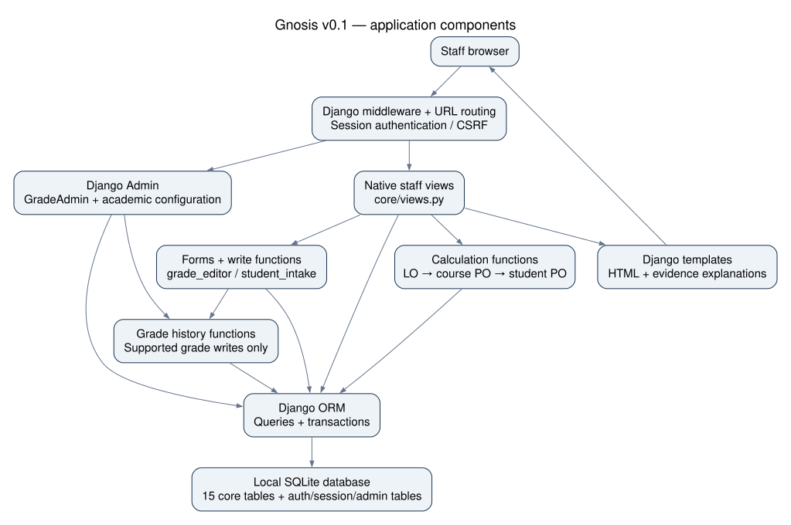
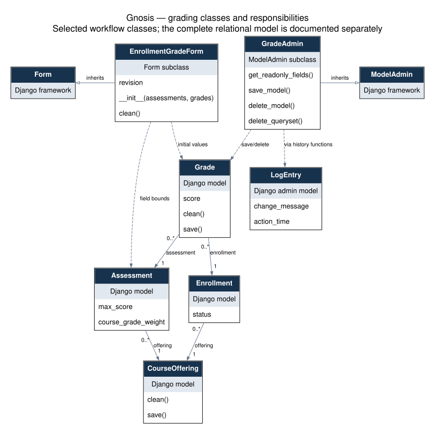
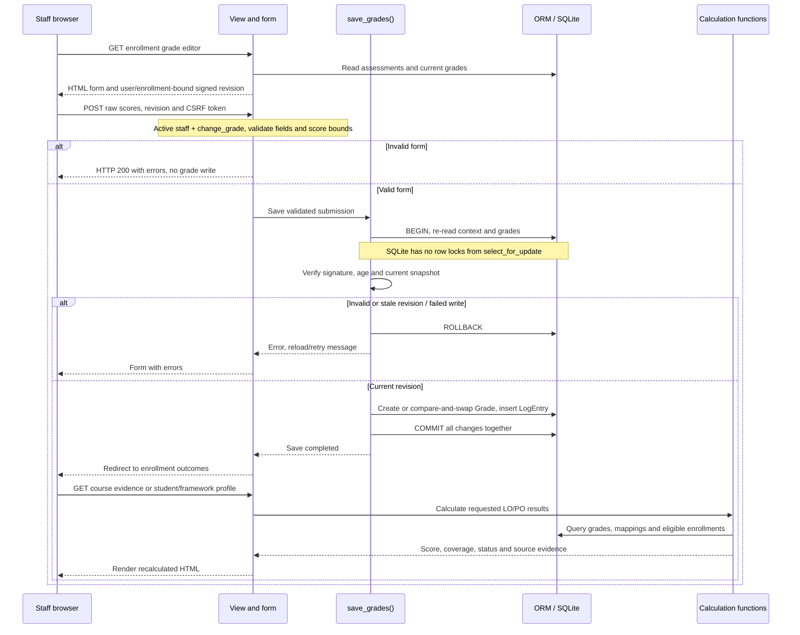
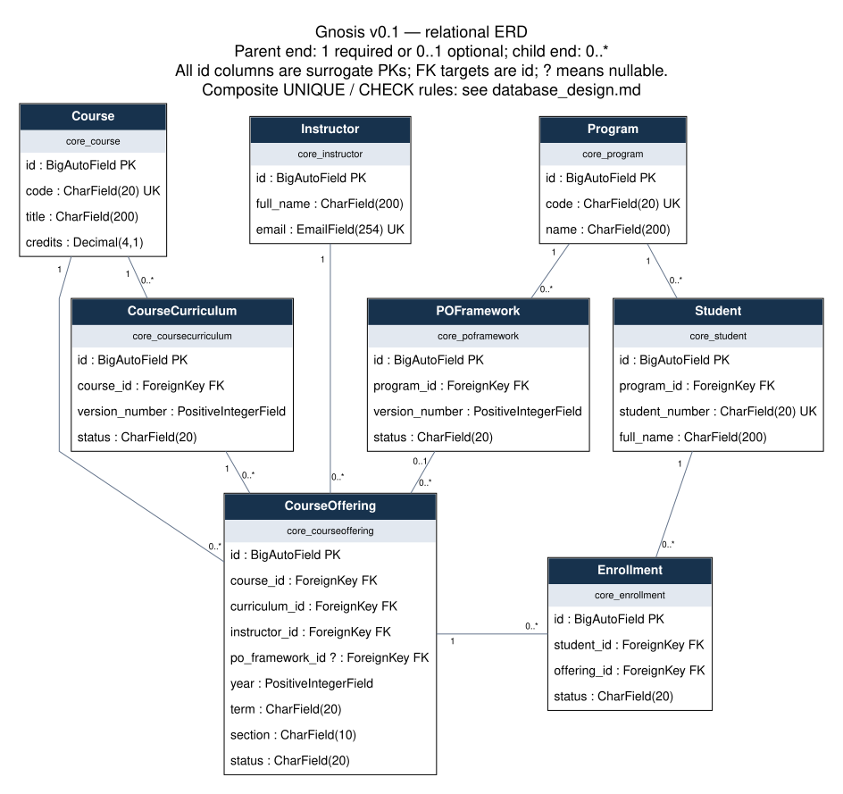
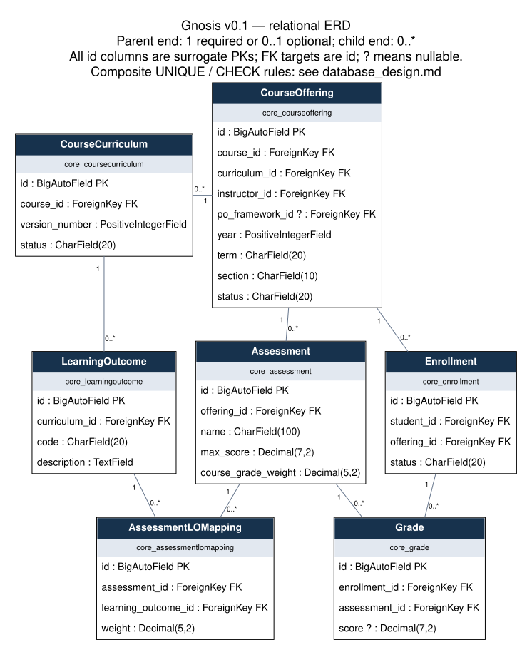
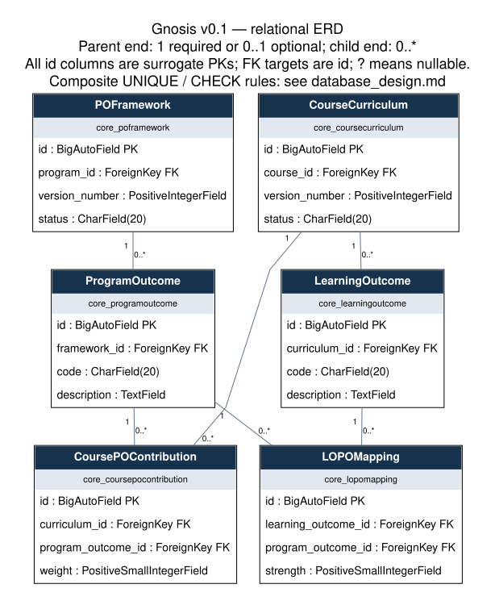

**Team name:** [Pending: confirm registered team name; product name is Gnosis]

**Team members:** [Pending: four registered names and any required student IDs]

**GitHub repository:** https://github.com/TugraDuygulu/gnosis

# Gnosis — CSE321 Data & System Architecture working draft

Checkpoint: **12 November 2026**. Source baseline: `eb23586b2b2f635629d9a08f5db1cfa6b0dee53a`, inspected 1 November 2026. This is a review workspace, not a final submission. Bracketed pending items require confirmation. Section names follow CSE321 Report Format 2 [S1]; source definitions are in [SOURCES.md](SOURCES.md).

## 1. Introduction

Gnosis is a web application for tracing assessment grades into Learning Outcome (LO) and Program Outcome (PO) attainment. The project brief identifies Acıbadem Computer Engineering as the initial pilot context [S2, S3]. Its purpose is to let staff maintain academic evidence and explain a student's calculated outcome profile, rather than present an unexplained percentage. The current v0.1 is a local staff application built with Python, Django and SQLite.

A staff member can browse students and course offerings, register a student record, enroll that student into an eligible existing offering, enter or correct raw assessment scores, inspect LO/course-PO/student-wide-PO results and evidence, and review supported grade changes. Registering a student creates an academic record, not a login account. Courses, curriculum versions, PO frameworks, outcomes, assessments and weighted mappings are configured through Django Admin.

Results separate **attainment** from **evidence coverage**. A recorded zero contributes evidence; a missing Grade or NULL score does not. Partial grading produces a provisional score from the evidence available, together with reduced coverage. Complete coverage does not mean passing or mastery. Grade changes are reflected when the result page is requested again; there is no stored attainment cache or background recalculation worker.

The pilot contains the official eleven PO definitions and clearly fictional students, courses, mapping choices and grades. It is not an institution-approved curriculum mapping. The owner accepted the minimum staff workflow in [v01_acceptance.md](../../v01_acceptance.md); that acceptance does not establish full-team/instructor approval or final-project completion.

Current boundaries are explicit: staff access is global rather than instructor-owned; Instructor is not linked to a Django User; students have no self-service portal. Retake/equivalence selection, publication freezes, bulk imports, notification integrations, a frontend/API decision and public deployment remain separate work. The SQL cohort summary is report evidence, not an additional native analytics screen.

## 2. System Design

### 2.1 Components and request paths

Figure 1. Implemented components and dependencies. [Editable Mermaid](diagrams/architecture.mmd) / [SVG](diagrams/architecture.svg). Arrows indicate request/data dependencies, not separately deployed services. This single Django application has no implemented Vue/API tier, message queue, external cache, notification service or cloud-storage dependency.

The browser receives server-rendered HTML from templates under `core/templates/core/`. `config.urls` routes `/admin/` into Django Admin and other paths into `core.urls`. Middleware supplies sessions, authentication, CSRF protection and other Django request safeguards. Function-based views in `core/views.py` select records, enforce access, invoke forms/write functions or calculation functions, and render the corresponding template.

The database boundary is Django's ORM and transaction API over a local SQLite file. The same database contains the 15 academic tables and Django authentication, session, content-type, migration and admin-history tables. Configured WSGI/ASGI entry points are framework entry points, not evidence of production hosting. Current settings use development DEBUG and no production host configuration. They must not be represented as a production deployment.

| Entry / component | Actual responsibility | Evidence |
| --- | --- | --- |
| `/`, `/courses/`, `/offerings/<id>/`, `/students/<id>/` | Staff navigation, search, exact offering roster, student enrollment links | [views](../../../core/views.py), [routes](../../../core/urls.py) |
| `/students/new/` | ModelForm registration, required/unique student details | [StudentRegistrationForm](../../../core/student_intake.py) |
| `/students/<id>/enroll/` | Offering eligibility and transactional active enrollment | StudentEnrollmentForm, available_offerings, enroll_student |
| `/enrollments/<id>/grades/` | Dynamic raw-score form and guarded transactional saves | [grade_editor.py](../../../core/grade_editor.py) |
| Enrollment/student outcome routes | Course evidence and exact-framework multi-course profile | [calculation functions](../../../core/services/), views and templates |
| Grade-history route and GradeAdmin | Supported native/Admin history using existing LogEntry | [grade_history.py](../../../core/grade_history.py), [admin.py](../../../core/admin.py) |

All native pages require active staff. Registration additionally requires `core.add_student`, enrollment `core.add_enrollment`, grade editing `core.change_grade`, and grade history `core.view_grade`. Read-only outcome/navigation pages use the staff gate without instructor-specific ownership. Templates hide relevant action links, while the server enforces permissions. Forms contain CSRF tokens; missing/invalid CSRF and permission boundaries have regression coverage. Django Admin independently applies its model permission checks.

### 2.2 Classes and behavior, separately from the ERD

Figure 2a. A focused class view of the grading workflow: framework inheritance, form dependencies, model validation methods, Admin hooks and object associations. [Mermaid source](diagrams/grading-classes.mmd). This is not the 15-table ERD, and it does not pretend to show every Django class. Domain classes marked “Django model” inherit Django Model; their full attributes/relationships are documented in Section 3.

`EnrollmentGradeForm` inherits Form, constructs Decimal score fields from Assessment maxima and existing Grade values, and rejects missing/duplicate/unexpected submitted score fields. `GradeAdmin` inherits ModelAdmin and supplies save/delete/history hooks; an existing grade's enrollment/assessment identity is read-only in Admin. Grade's `clean()`/validating `save()` enforce bounds and offering consistency, and CourseOffering validates agreement with its curriculum's course.

The intake path has separate `StudentRegistrationForm` (ModelForm), `StudentEnrollmentForm` (Form), and `OfferingChoiceField` (ModelChoiceField). The latter limits choices to compatible existing offerings. Core views and calculators are **functions in modules**, not invented Controller/Service classes. `calculate_student_po_achievement()` calls course-PO calculation, which calls LO calculation; their result dictionaries contain score, coverage and status plus provenance for the profile.

### 2.3 Grade-save and result-inspection workflow

The [sequence diagram](diagrams/grade-workflow.mmd) distinguishes form validation, transactional saving and the subsequent read request.

Figure 2b. Grade-save and subsequent request-time calculation. The editable source above is kept in sync with the linked sequence file.

On GET, the grade editor reads one enrollment's assessments/grades and signs a revision tied to that enrollment and user. On POST, the view validates permissions, CSRF, field shape and Decimal bounds. `save_grades()` opens an atomic transaction, rereads the editing context, verifies the signed token (maximum age two hours) and compares the current snapshot. It creates missing nonblank grades or conditionally updates an existing grade against its old value. A supported change also inserts a structured LogEntry in the same transaction. Blank input can clear an existing score; unchanged values do not generate history.

After successful commit the browser is redirected to course evidence. A later student/framework request calculates its own multi-course profile. The view invokes calculators, the calculators query ORM-backed grades/mappings, and templates display scores, coverage and sources. This is request-time calculation after saving, not an event-driven update of stored result columns. Invalid or stale submissions return errors; failed atomic saves roll back their writes.

History includes actor/time and assessment/value snapshots for native editor and GradeAdmin writes. It is not immutable, not backfilled, and not automatically generated by arbitrary ORM updates, seed commands or raw SQL. It cannot by itself reconstruct every historical outcome calculation after mappings/framework configuration changes.

## 3. Data Model

### 3.1 Entities, relationships and schema shape

The verified design contains 15 application models, 64 physical columns and 20 FKs through core.0009. The complete [ERD](../../diagrams/gnosis-erd.svg) and [schema narrative](../../database_design.md) are retained as authoritative supporting material. For the report use these focused figures at readable size:

Figure 3a. Academic identities, curriculum/framework versions, offerings and enrollments.

Figure 3b. Assessment/grade/LO evidence relationships.

Figure 3c. LO→PO strengths and curriculum→PO contribution weights. Repeated boxes across views denote the same tables. Full [field dictionary](../../data/pilot_2026-11-01/field_dictionary.md), [physical DDL](../../data/pilot_2026-11-01/schema_inventory.json) and Mermaid sources provide the exact detail.

Program owns Students and versioned POFrameworks; each PO belongs to one framework. Course owns curriculum versions and offerings; LOs belong to a curriculum. An offering chooses one curriculum, one instructor and an optional exact PO framework. Enrollment joins a student to an offering; Grade joins an enrollment to an assessment. AssessmentLOMapping, LOPOMapping and CoursePOContribution store distinct evidence weights, LO→PO strengths and curriculum-version→PO contribution weights. Instructor is academic data, separate from auth User.

Each table has an integer surrogate PK, represented by Django BigAutoField and SQLite INTEGER PRIMARY KEY AUTOINCREMENT. Four scalar UNIQUE rules and ten composite UNIQUE rules prevent duplicate identities/associations. Parent collections can be empty; the diagram must not imply every curriculum/framework already has outcomes. Only offering.po_framework_id and Grade.score are nullable.

Named SQL CHECKs enforce positive assessment maxima, positive AssessmentLOMapping weights, and 1–5 LO→PO strengths/course contributions. Backend-generated positive-integer checks allow zero for version/year. All model FKs use Django PROTECT, while actual SQLite DDL uses deferred NO ACTION references. Cross-table grade/offering/curriculum consistency and grade upper bounds are application validation, not SQL CHECKs. SQLite type affinity does not strictly enforce Django varchar length or decimal precision. The detailed constraint table in database_design.md distinguishes these boundaries.

The schema is an operational relational design, not a star/snowflake warehouse. Separate entity/association tables avoid repeating outcome lists and score columns, and unique endpoint pairs constrain mapping facts. However, strict 3NF/BCNF throughout would be an overclaim: CourseOffering stores course_id as well as curriculum_id, although a curriculum determines its course. Django checks agreement on save; SQL FKs alone do not enforce it. Historical configurations remain editable and raw/bulk writes can bypass validating saves. These are documented trade-offs/limitations, not newly approved redesign decisions.

### 3.2 How assessment evidence reaches a PO profile

LO scores normalize raw marks by the assessment maximum and average using AssessmentLOMapping's relative weights. The score denominator contains graded weights only; coverage compares graded weight with all configured weight. Course POs then use LO→PO strengths adjusted by LO coverage. Student POs use CoursePOContribution weights adjusted by course-PO coverage. Credits and assessment course-grade weights are not substitutes for these fields. Decimal arithmetic retains precision between layers; display rounding does not drive status.

Student-wide aggregation selects active enrollments in offerings assigned to the exact requested framework, checks program compatibility, reports unmapped enrollments separately and rejects repeated mapped courses pending retake policy. Coverage is evidence among selected mapped enrollments, not institutional completion of all required courses. See [calculation_policy.md](../../calculation_policy.md).

### 3.3 Measured rows, columns and raw storage

The November 1 fictional checkpoint was created in a fresh temporary database using migrate + seed_pilot once, with no auth-user/login activity. No private development records were used. Fresh issue #3 verification reproduces the schema and row counts; original measurements remain in [table_metrics.md](../../data/pilot_2026-11-01/table_metrics.md).

| Physical application table | Columns | Rows | Record payload bytes | Table allocated bytes | Index allocated bytes |
| --- | ---: | ---: | ---: | ---: | ---: |
| `core_assessment` | 5 | 4 | 58 | 4096 | 4096 |
| `core_assessmentlomapping` | 4 | 6 | 44 | 4096 | 12288 |
| `core_course` | 4 | 2 | 96 | 4096 | 4096 |
| `core_coursecurriculum` | 4 | 2 | 21 | 4096 | 8192 |
| `core_courseoffering` | 9 | 2 | 54 | 4096 | 20480 |
| `core_coursepocontribution` | 4 | 5 | 38 | 4096 | 12288 |
| `core_enrollment` | 4 | 4 | 48 | 4096 | 12288 |
| `core_grade` | 4 | 8 | 57 | 4096 | 12288 |
| `core_instructor` | 3 | 1 | 62 | 4096 | 4096 |
| `core_learningoutcome` | 4 | 4 | 224 | 4096 | 8192 |
| `core_lopomapping` | 4 | 7 | 53 | 4096 | 12288 |
| `core_poframework` | 4 | 1 | 10 | 4096 | 8192 |
| `core_program` | 3 | 1 | 45 | 4096 | 4096 |
| `core_programoutcome` | 4 | 11 | 2225 | 4096 | 8192 |
| `core_student` | 4 | 2 | 56 | 4096 | 8192 |

Application totals are 64 columns and 60 rows. The complete file was 344,064 bytes (84 × 4096-byte pages), including infrastructure tables, indexes and the SQLite catalog. `dbstat` record payload is encoded record content; allocated bytes include unused space/page overhead. Small tables each occupy a full page. These are measured checkpoint values, not production capacity estimates or final-stage sizes. Python SQLite 3.50.4 created the DB; read-only SQLite CLI 3.54.0 supplied dbstat. Refresh the selected fictional snapshot for the November checkpoint if changed, and again for final-stage reporting [S1 §3].

### 3.4 Executable SQL evidence

[The three query guide and actual results](../../../sql/README.md) support this model with executable SQL and independent verification:

| Question | Relational operations | Actual pilot interpretation |
| --- | --- | --- |
| Student assessment grades in an offering | INNER JOIN academic context; LEFT JOIN Grade on enrollment AND assessment; CASE for absent/NULL/recorded | PILOT001 Project 40/50 normalizes to 80; zero remains recorded evidence |
| Weighted per-student LO attainment | Offering-filtered mappings, GROUP BY LO, SUM weighted normalized scores, graded/configured denominators | PILOT001/PILOT311 LO1=86 and LO2=580/7; PILOT002 LO1=70 with 60% coverage |
| Offering LO summary | Per-student evidence CTE, active roster, GROUP BY LO, AVG and CASE counts | PILOT321 LO2 mean=80, but mean coverage=50%; no-data student is excluded from score mean only |

The owner-approved SQL summary uses equal-student averaging and includes provisional scored students. It is report evidence rather than an implemented web screen or institution-mandated cohort policy. Seventeen standalone SQL cases compare manual expectations and Decimal service results; SQLite REAL differences are tolerated at 1e-9 percentage points, with observed maximum about 4.2857e-15. Full SQL, parameters, expected/actual tables and the isolated reproduction command remain in the linked guide/evidence directory. These 17 cases are separate from the existing 69-test CI suite.

## 4. Scalability and Fault Tolerance

The application currently has 34 academic secondary indexes: 14 unique autoindexes and 20 ordinary Django FK indexes. SQLite's table PK uses the rowid B-tree itself. The [index inventory](../../data/pilot_2026-11-01/index_inventory.md) names each index and column order. Indexed equality joins and unique endpoint lookups support the current data paths; no benchmark or measured speedup is claimed. Student/course text search uses contains filters, so the existing identity/FK indexes should not be advertised as an optimized full-text search design.

No application materialized views, cubes, partitioning, replication or external result cache are implemented. Outcome calculations query data on demand. Calculation loops may repeat ORM work for each LO/assessment/PO; this is a source-based scaling concern, not a measured latency result. History is paginated in pages of 50, while other listing/result paths need measurement before large-cohort claims. Query counts, realistic volume/load, response latency and query-plan analysis remain pending if used to justify a later optimization.

SQLite serializes writers and can return lock conflicts. Atomic writes and database uniqueness protect supported operations from partial saves/duplicate facts; the native views catch supported stale/uniqueness/locking conflicts and show reload/retry messages. Other database errors can still fail a request. The SQLite journal supports transactional rollback, but this project has not demonstrated power-loss recovery, automatic backup/restore, process failover or high availability. There is no replicated node that takes over after local database or host failure.

Potential later work includes profiling ORM queries, then deciding whether query consolidation, additional indexes, caching or another database engine is justified. These are proposals requiring separate approval and validation. No hosting/provider/database-engine change follows from this report draft. A genuine backup/restore exercise and load/concurrency limits should be documented before claiming operational fault tolerance.

## 5. Consistency

### 5.1 Actual transaction boundaries

| Path | Boundary and purpose | Source / evidence |
| --- | --- | --- |
| Native student registration | View wraps ModelForm save in atomic; catches duplicate/lock conflicts outside it | views.student_register; intake regression tests |
| Native enrollment | enroll_student is atomic; rereads student/offering eligibility before inserting; UNIQUE pair is final duplicate guard | student_intake.py |
| Native grade changes/history | save_grades is atomic; validates revision/current context, conditionally updates grades and inserts history together | grade_editor.py; GradeHistoryTests rollback-on-second-log test |
| Grade Admin add/change | Django ModelAdmin's write changeform_view supplies atomic scope; custom save hook writes structured history | installed Django source; GradeAdmin.save_model |
| Grade Admin delete/bulk delete | Custom delete hooks are atomic and record history before deletion | core/admin.py; Admin rollback regression tests |
| Fictional seeds | Each seed handle uses atomic with get_or_create; reruns preserve edits | management/commands/seed_demo.py and seed_pilot.py |
| Outcome reads | Ordinary ORM reads; no enclosing atomic snapshot around the whole outcome page | calculation services and outcome views |

For grade edits, signed revision checks prevent use of another user's/enrollment's form and detect changes to the included grades/assessment maxima/context. Existing-row writes also compare-and-swap against the old score. The SQL update bypasses model save, so supported safety depends on validated form values and rechecked context. Mapping/version publication is not frozen by this mechanism. Tests verify rollback of multiple grade/history changes if a later operation fails; this does not establish safe arbitrary raw SQL writes.

### 5.2 Isolation and verified concurrency behavior

The settings select SQLite without a transaction-mode override or ATOMIC_REQUESTS. In a **fresh file using these settings**, inspection found Django autocommit enabled, atomic blocks issuing `BEGIN` (deferred), `read_uncommitted=0`, `journal_mode=delete`, foreign keys enabled and a 5000 ms connection busy timeout. The driver property `isolation_level=None` expresses driver autocommit management; it is not a claim that SQLite provides no isolation.

SQLite documents serializable transactions with serialized writes outside the shared-cache/read-uncommitted exception [S4]. Our separate file-backed connections used no shared-cache request. A temporary experiment confirmed: another connection saw 10 while an uncommitted update held 20; after commit it saw 20; a competing writer received SQLITE_BUSY; rollback preserved 20; and an active reader blocked another writer's commit in rollback-journal mode. Nested Django atomic blocks emitted a savepoint/rollback-to/release and preserved outer value 50 after inner value 60 was rolled back. [Raw observations](evidence/sqlite_consistency.json) and [reproduction script](tools/probe_sqlite_consistency.py) are retained.

Django's SQLite backend reports `has_select_for_update=False`; the generated query contains no FOR UPDATE [S5]. Thus calls to select_for_update must not be described as row-lock guarantees on this backend. The probe's competing connections used zero timeout to expose locking immediately, distinct from the application's measured 5000 ms timeout. The original development file's journal mode was not inspected or changed. No WAL experiment, concurrent HTTP stress test or power-loss proof is claimed.

Serializable database transactions do not make a multi-query, non-atomic outcome page one immutable snapshot. A concurrent supported change between separate reads could produce a mixed read view; this is a source-based limitation requiring a targeted reproduction if a report claims a stronger page-level guarantee. Framework/curriculum edits can also change historical calculations. No application change is made here; any snapshot/configuration-freeze improvement needs separate scope and review.

## 6. Teamwork

The team is required to contain four students [S2]. **Registered team name, the complete four-person roster, confirmed responsibilities and member-reviewed contribution evidence remain pending.** This section is deliberately incomplete rather than attributing work from guesses or Git author identity alone.

| Person / role | What is currently supported | Confirmation still needed |
| --- | --- | --- |
| Tuğra Duygulu, project owner | Requirements/design review and approval of the bounded AI-assisted workflow, minimum staff scope and reviewed changes are recorded in project handoffs/PRs | Confirm registered spelling/ID and personally authored implementation/report tasks |
| Other three registered members | No individual work allocation asserted in this draft | Names/IDs, actual completed tasks, commit/PR/design/review links and their confirmation |
| AI assistance (not a team member) | Assistant implementation/testing/documentation with owner review, as allowed by Guidelines p.10 | Agree final disclosure wording and verify that every member understands their presented material |

Actual repository evidence includes merged [PR #19](https://github.com/TugraDuygulu/gnosis/pull/19) (native intake), [#20](https://github.com/TugraDuygulu/gnosis/pull/20) (verification closeout), [#21](https://github.com/TugraDuygulu/gnosis/pull/21) (database documentation) and [#22](https://github.com/TugraDuygulu/gnosis/pull/22) (SQL evidence). The latest SQL PR's [Actions run 41314157582](https://github.com/TugraDuygulu/gnosis/actions/runs/41314157582) checks the 69 Django tests; the standalone 17 SQL cases were verified locally. Neither a passing CI run nor owner approval is teammate peer review. No sprint velocity, member contribution count or historical team sign-off is manufactured.

Before submission, collect the four members' factual task descriptions and evidence, agree presentation ownership, review the drafted architecture/consistency claims together, and check the rendered report's header and 125% code/figure readability. The [requirements/evidence checklist](REQUIREMENTS_EVIDENCE.md) and [remaining work](MISSING_INFORMATION.md) identify the unfinished items. No final submission file is generated at this checkpoint.
